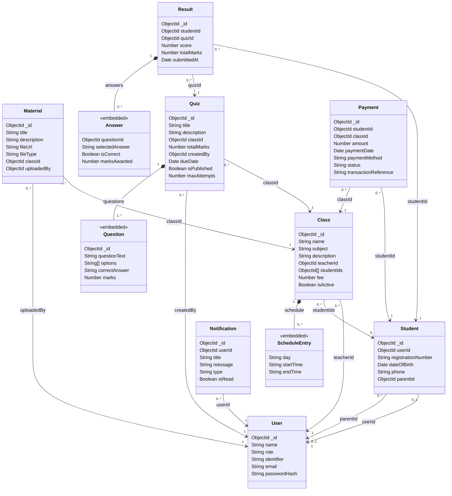

# EduTrack UML Class Diagram

Jira: EDU-57 — Class and Sequence Diagrams. Reviewed on 8 November 2026 against the eight Mongoose models in `backend/models/` at commit `363e76c`.

Artifacts: [white-background SVG](CLASS-DIAGRAM.svg) and [Mermaid source](CLASS-DIAGRAM.mmd). The SVG was rendered successfully with Mermaid CLI, validating the diagram syntax.

## Implemented schema structure

## Main classes and relationships

`User` stores authentication accounts. `Student` is a separate profile linked to one User, with an optional parent User reference. The unique `Student.userId` index permits at most one Student profile per User when the index is present. Teacher, Parent, and Admin are User role values, not separate models or subclasses.

`Class` references a teacher User and an array of Student profiles. `Material` references its Class and uploader User. `Quiz` references its Class and creator User, and embeds its questions. `Result` references a Student and Quiz and embeds answer records. `Payment` references a Student and Class. `Notification` references its recipient User. Composition diamonds identify embedded data, not separately stored collections; `ScheduleEntry`, `Question`, and `Answer` are explanatory names for existing embedded structures.

Cardinalities describe declared scalar/array references and required fields, not enforced foreign-key integrity. Mongoose `ref` does not ensure that a target exists or has the expected role. In particular, `teacherId`, `parentId`, `uploadedBy`, and `createdBy` do not validate User roles. Reference arrays do not enforce uniqueness. No cascade deletion is declared. The diagram's `1` reference ends mean a required ID value, not a guarantee of a matching stored document.

All eight top-level models include generated `_id`, `createdAt`, and `updatedAt` fields. Timestamps are omitted from the diagram for readability. Embedded questions have `_id`; embedded answers explicitly disable `_id`. Schedule entries use Mongoose's default subdocument IDs, omitted from the diagram.

## Important validation constraints

| Class | Implemented constraints and defaults |
|---|---|
| User | Required name (trimmed, maximum 100), role, identifier, passwordHash. Roles: student, teacher, parent, admin. Identifier is trimmed and unique. Optional email is trimmed, lowercased, email-pattern validated, unique and sparse. |
| Student | Required unique userId and registrationNumber; registration is trimmed and uppercased. Optional dateOfBirth cannot be in the future. Optional phone matches an optional `+` followed by 7–15 digits. parentId defaults to null. |
| Class | Required name (maximum 100), subject, teacherId, fee. Description maximum 500. Fee at least 0. isActive defaults true. Each schedule entry requires a weekday, HH:mm start/end times, and end later than start; the ordering check is a document pre-validation hook. Empty schedule/student arrays are allowed. |
| Material | Required title (maximum 150), fileUrl, classId, uploadedBy. Description maximum 500. URL must parse with HTTP/HTTPS protocol. fileType: pdf, document, video, image, other; default other. |
| Quiz | Required title (maximum 150), classId, totalMarks (at least 1), createdBy, maxAttempts. Description maximum 500. At least one question. Optional dueDate must be in the future when validated. isPublished defaults false. maxAttempts is an integer at least 1, default 1. |
| Question | Required questionText, options, correctAnswer, marks. At least two nonempty options; duplicate detection ignores surrounding whitespace and case. correctAnswer must exactly match an option. Marks at least 1. |
| Result | Required studentId, quizId, score, totalMarks. Score at least 0 and no greater than totalMarks; totalMarks at least 1. submittedAt defaults to the current time. answers defaults to an empty array. |
| Answer | Required questionId. selectedAnswer is trimmed. isCorrect defaults false. marksAwarded defaults 0 and cannot be negative. |
| Payment | Required studentId, classId, amount (at least 0.01), paymentMethod. Methods: cash, bank_transfer, card, online, other. Status: pending, completed, failed, refunded; default pending. paymentDate defaults to current time. Optional transactionReference is trimmed, unique and sparse. |
| Notification | Required userId, title (maximum 150), message (maximum 1000). Type: quiz, material, class, payment, result, general; default general. isRead defaults false. |

String trimming and maximum lengths above describe the schema declarations; they do not imply additional API endpoints. Update operations must enable applicable validators; document hooks and cross-field validators do not automatically provide identical behavior for every update method. Unique constraints are database indexes rather than Mongoose validation rules, and require the indexes to exist in the database.

## Declared indexes

All models have the default `_id` index. Additional declared indexes follow; `1` means ascending and `-1` descending. Database index deployment was not checked for this document.

| Model | Index declarations |
|---|---|
| User | Unique identifier; unique sparse email |
| Student | Unique userId; unique registrationNumber |
| Class | `(teacherId: 1, isActive: 1)`; `(studentIds: 1)` |
| Material | `(classId: 1, createdAt: -1)`; `(uploadedBy: 1)` |
| Quiz | `(classId: 1, isPublished: 1)`; `(createdBy: 1, createdAt: -1)` |
| Result | `(studentId: 1, submittedAt: -1)`; `(quizId: 1)`; `(studentId: 1, quizId: 1, submittedAt: -1)` |
| Payment | Unique sparse transactionReference; `(studentId: 1, paymentDate: -1)`; `(status: 1, paymentDate: -1)`; `(classId: 1)` |
| Notification | `(userId: 1, isRead: 1, createdAt: -1)`; `(createdAt: -1)` |

## Implemented boundaries and future functionality

Every arrow shown comes from an actual ObjectId `ref` or embedded array. `Answer.questionId` is an ObjectId without a Mongoose `ref`; the diagram deliberately does not claim an enforced Question relationship. Notification type values do not create links to Quiz, Material, Class, Payment, or Result documents.

No Enrollment, Teacher, Parent, Admin, or authentication-session collection is declared. No unique Student–Quiz result constraint is declared, so the model permits multiple results for a pair. Class enrollment uniqueness, reference existence checks, role restrictions on referenced users, matching result answers to quiz questions, and automatic total-mark reconciliation would require additional validation or service logic. These are potential extensions, not implemented relationships or guarantees. No proposed relationships or sequence diagram are included.
