# EduTrack Login Sequence Diagram

Jira: EDU-57 ? Class and Sequence Diagrams. Reviewed on 8 November 2026 against the working source at commit `5f2bcd7`.

Artifacts: [white-background SVG](LOGIN-SEQUENCE.svg) and [Mermaid source](LOGIN-SEQUENCE.mmd).

## Implemented authentication sequence

```mermaid
sequenceDiagram
    autonumber
    actor Person as Student or Teacher
    participant Mobile as React Native mobile application
    participant Store as Expo SecureStore
    participant API as Node.js / Express backend
    participant DB as MongoDB database

    rect rgb(245,248,252)
    Note over Person,DB: Interactive login
    Person->>Mobile: Choose role and submit identifier/password
    Mobile->>Mobile: Trim identifier, validate required fields,<br/>email where applicable, password length at least 8,<br/>supported role and configured API URL
    alt Client validation fails
        Mobile-->>Person: Display validation error, no request sent
    else Client validation passes
        Mobile->>Mobile: Invalidate older session checks, show login loading
        Mobile->>API: POST /api/auth/login<br/>{role, identifier, password}
        alt Network failure or response cannot be parsed
            Note over Mobile,API: No usable response reaches the client,<br/>server outcome may be unknown
            Mobile-->>Person: Display connection error, remain on login
        else JSON response received
            API->>API: Validate role and required string fields
            alt Invalid server input
                API-->>Mobile: 400 {message}
                Mobile-->>Person: Display backend validation message
            else Valid server input
                API->>API: Normalize identifier for selected role
                API->>DB: User.findOne(role-constrained query)
                DB-->>API: User document or no match
                alt No matching account
                    API-->>Mobile: 401 invalid login details
                    Mobile-->>Person: Display login error
                else Account found
                    API->>API: bcrypt.compare(password, user.passwordHash)
                    alt Password mismatch
                        API-->>Mobile: 401 invalid login details
                        Mobile-->>Person: Display login error
                    else Password matches
                        API->>API: jwt.sign(sub = user.id, role = user.role,<br/>server secret, expiresIn = 2h)
                        API-->>Mobile: 200 {token, user: id/name/role/identifier}
                        Mobile->>Mobile: Require token and user,<br/>check returned role matches selected role
                        alt Response fails client checks
                            Mobile-->>Person: Display sign-in or role error
                        else Response accepted
                            Mobile->>Store: setItemAsync(edutrack_token, token)
                            alt Secure write succeeds
                                Store-->>Mobile: Promise resolves
                                Mobile->>Mobile: setUser(user), clear password,<br/>setPage(dashboard)
                                Mobile-->>Person: Student or Teacher dashboard<br/>only when user.role equals selected role
                            else Secure write fails
                                Store-->>Mobile: Promise rejects
                                Mobile-->>Person: Existing generic connection error,<br/>session is not set to authenticated
                            end
                        end
                    end
                end
            end
        end
        Mobile->>Mobile: Clear login loading in finally
    end
    end

    rect rgb(248,250,245)
    Note over Person,DB: Separate path on app startup: restoreSession
    Mobile->>Mobile: Show checking-session indicator,<br/>start version guard and 10-second abort timer
    Mobile->>Store: getItemAsync(edutrack_token)
    Store-->>Mobile: Saved token or no token
    alt No saved token
        Mobile->>Mobile: Clear user, show Welcome
    else Saved token exists
        Mobile->>API: GET /api/auth/me<br/>Authorization: Bearer token
        API->>API: requireAuth: jwt.verify signature and expiry
        alt Invalid, expired, missing or malformed Bearer token
            API-->>Mobile: 401 {message}
        else JWT verified
            API->>API: Validate subject is a 24-character hex string
            alt Invalid subject
                API-->>Mobile: 401 Invalid session
            else Valid subject
                API->>DB: User.findById(sub).select(name role identifier)
                DB-->>API: Current account or no match
                alt Missing account or unsupported database role
                    API-->>Mobile: 401 account unavailable
                else Existing Student or Teacher
                    API-->>Mobile: 200 {user: id/name/role/identifier}
                end
            end
        end
        alt 200 with valid supported user fields
            Mobile->>Mobile: setUser(user), setRole(user.role),<br/>setPage(dashboard)
            Mobile-->>Person: Correct Student or Teacher dashboard
        else 401 received
            Mobile->>Store: deleteItemAsync(edutrack_token)
            alt Secure deletion succeeds
                Store-->>Mobile: Promise resolves
                Mobile->>Mobile: Clear user, show Welcome
            else Secure deletion fails
                Store-->>Mobile: Promise rejects
                Mobile-->>Person: Session verification error, Retry or Welcome
            end
        else Network error, timeout, non-OK response or malformed user
            Mobile->>Mobile: Do not restore user, preserve saved token
            Mobile-->>Person: Session verification error,<br/>Retry session check or Continue to Welcome
        end
    end
    Mobile->>Mobile: Clear abort timer in finally
    Note over Mobile,API: After asynchronous steps, stale restoration results are ignored<br/>when a newer check, login, logout or unmount invalidates their version
    end
```

## Explanation

The first section traces a Student or Teacher submitting credentials, mobile validation, Express validation, MongoDB account lookup, bcrypt password comparison, JWT generation, secure token storage, and role-protected dashboard display. Invalid credentials never produce an authenticated mobile session. Expo SecureStore is shown separately because its asynchronous success or failure controls whether the app completes login.

The second section is a separate app-startup path, not an automatic continuation of the interactive login. The mobile app retrieves a saved token and verifies it through `GET /api/auth/me` before trusting the session. The backend verifies the JWT, validates its subject, and retrieves the current Student/Teacher account. Successful restoration sets both the user and role. A 401 triggers secure token deletion and Welcome navigation; transient failures retain the token and offer a safe retry. Async restoration results use the existing version checks to avoid overwriting newer authentication state.

## Source fidelity and simplifications

- Sources: [mobile application](../../mobile/App.js), [API routes](../../backend/server.js), [JWT middleware](../../backend/middleware/auth.js), and [User schema](../../backend/models/User.js).
- The client trims identifiers, requires credentials, validates email syntax for Teacher login or Student email input, and requires a password of at least eight characters. Parent/Admin login is blocked, and a missing API URL prevents a login request. Server login validation only requires a supported role and nonempty string credentials; it does not impose the mobile password-length or email-format checks.
- Student lookup constrains role and matches an uppercase registration identifier or lowercase email. Teacher lookup constrains role and matches the lowercased identifier field. Password hashes remain server-side; bcrypt comparison and JWT signing occur in Node.js, not MongoDB. Tokens expire after two hours.
- Network failure is represented as a client-observed outcome of an attempted request; the server may still process it. The network alternative does not imply that Express waits for a client parsing outcome before handling a request. Response handling and server processing are condensed into one diagram for readability.
- Backend exceptions during login or current-user lookup return HTTP 500 with a generic message. These exception branches are summarized here rather than repeated around every database/crypto call. Login displays returned backend errors; startup restoration handles non-OK responses as verification failures. JSON-parser errors before the login route can follow Express default error handling.
- The current login catch block uses the same connection error for network, response parsing, and SecureStore write failures. The diagram records this behavior rather than claiming a separate storage-specific message exists.
- Session restoration also handles SecureStore read failures and missing API configuration through its verification-error screen. It starts an abort timer before the secure read; that timer aborts fetch, not SecureStore operations. No token is trusted solely because it exists in storage.
- Restoration's success checks require a nonempty string user ID, string name/identifier and Student/Teacher role. Its backend lookup requires a hexadecimal ObjectId subject. Deleted or unsupported-role accounts are rejected with 401. Schema support for Parent/Admin does not enable their authentication.
- The existing version guard is shown for restoration only; it is not a claim that every asynchronous operation in the app is cancellable. Returning stale checks do not update authentication state. The interactive login remains the existing implementation.
- The User schema is a Mongoose model for persisted accounts; no additional database write, session collection, refresh token, registration endpoint, or server logout is implied. The protected Teacher-data loading workflow is outside this login diagram.
- Message labels name fields and operations only. No passwords, JWT values, database secrets or real account details are included.

## Validation

The Mermaid source is intended to match the fenced diagram exactly. Mermaid CLI rendering validates syntax and generates the SVG on a white background. Flow decisions were cross-checked against the source files above; no application, schema, or environment changes are required. This is documentation validation, not a new runtime authentication test.
